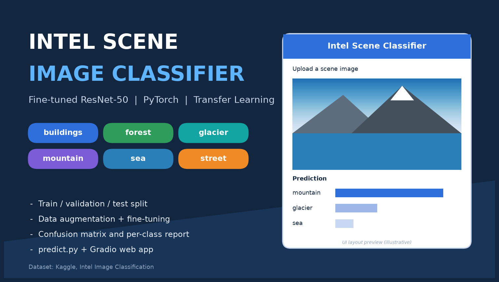
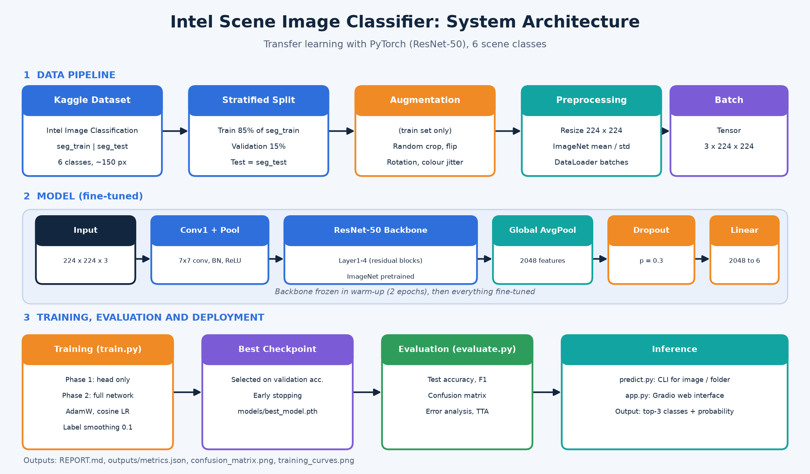

# Intel Scene Image Classifier (PyTorch, Transfer Learning)

Fine-tunes an ImageNet-pretrained **ResNet-18** (ResNet-50, MobileNetV3 and EfficientNet-B0 are also supported via `--arch`) to classify natural and urban scenes into **6 classes**:
`buildings`, `forest`, `glacier`, `mountain`, `sea`, `street`.


Includes train/validation/test splits, data augmentation, evaluation with a confusion matrix,
a command-line predictor and a Gradio web interface.

## Architecture



## Dataset

- **Name:** Intel Image Classification
- **Source:** <https://www.kaggle.com/datasets/puneet6060/intel-image-classification>
- **Size:** about 25,000 colour images (about 150×150 px) in 6 classes; original folders `seg_train` (~14k), `seg_test` (~3k) and `seg_pred` (~7k, unlabeled, not used for training).
- **Licence:** see the Kaggle page. The dataset is not included in this repository.

| Split | Origin |
|---|---|
| Train (85%) | stratified part of `seg_train` |
| Validation (15%) | stratified part of `seg_train` (model selection, early stopping) |
| Test | official `seg_test` (used once, for the final evaluation) |

Download and extract into `data/` so that the layout is:

```
data/
├── seg_train/seg_train/<class folders>
├── seg_test/seg_test/<class folders>
└── seg_pred/seg_pred/            (unlabeled, optional)
```

Using the Kaggle CLI: `kaggle datasets download -d puneet6060/intel-image-classification -p data --unzip`

## Project structure

```
.
├── config.py            # paths and global settings
├── dataset.py           # splits, augmentation, DataLoaders (python dataset.py = dataset summary)
├── model.py             # pretrained backbone, head replacement, checkpoint loading
├── train.py             # two-phase fine-tuning (warm-up head, then full network)
├── evaluate.py          # test accuracy, classification report, confusion matrices
├── predict.py           # CLI prediction for an image or a folder
├── app.py               # Gradio web interface
├── generate_report.py   # builds REPORT.md from the saved results
├── make_assets.py       # regenerates assets/architecture.png and assets/preview.png
├── assets/              # architecture diagram and preview image
├── models/best_model.pth   # trained weights (created by train.py)
├── outputs/             # metrics.json, history.json, plots
├── REPORT.md            # project report (created by generate_report.py)
└── requirements.txt
```

## Setup

```bash
python -m venv venv
venv\Scripts\activate          # Windows  (Linux/Mac: source venv/bin/activate)
pip install -r requirements.txt
```

A CUDA GPU speeds training up a lot (about 1 min/epoch on a Colab T4 with ResNet-50). On CPU, use `--arch resnet18` and fewer epochs, as in the submitted run. Pretrained weights are downloaded automatically on the first run (internet required).

## Usage

```bash
python dataset.py                 # 1. verify the dataset and class counts
python train.py                   # 2. fine-tune (saves models/best_model.pth)
python evaluate.py --tta          # 3. test accuracy + confusion matrix (saved in outputs/)
python generate_report.py         # 4. write REPORT.md with the real numbers
python predict.py --image path/to/image.jpg      # 5a. predict one image (or a folder)
python app.py                                     # 5b. web interface
```

Useful training options: `--arch {resnet18,resnet50,mobilenet_v3_large,efficientnet_b0}`, `--epochs`, `--batch-size`,
`--workers`, `--data-dir`. Run `python train.py --help` for all of them.

If you run in Google Colab, upload the project folder, run `!pip install -r requirements.txt`,
download the dataset with the Kaggle CLI (command above), and use `--workers 2`.

## Method (summary)

- **Model:** ResNet-18 (ImageNet weights), new classifier head (dropout 0.3 + linear layer). Final run trained on CPU with `--arch resnet18 --epochs 8`.
- **Augmentation (train only):** random resized crop, horizontal flip, rotation ±15°, colour jitter.
- **Training:** 2 warm-up epochs with a frozen backbone, then full fine-tuning with AdamW
  (backbone LR 1e-4, head LR 1e-3), cosine LR schedule, label smoothing 0.1, mixed precision, early stopping on validation accuracy.
- **Evaluation:** accuracy, precision/recall/F1 per class, confusion matrix (counts and normalised),
  optional test-time augmentation (horizontal flip), gallery of confident mistakes.

## Results

Final run: ResNet-18, 8 epochs, CPU, test-time augmentation on (`python evaluate.py --tta`).

| Metric | Value |
|---|---|
| Test accuracy | **89.60%** (3,000 test images) |
| Macro F1 / Weighted F1 | 0.8975 / 0.8957 |
| Best classes (F1) | forest 0.978, sea 0.943 |
| Weakest classes (F1) | mountain 0.835, glacier 0.840 |
| Weights file | `models/best_model.pth` |

Glacier and mountain are confused with each other most often (snow-covered mountains), and buildings/street also overlap.
A longer run or a larger backbone (`--arch resnet50`, ideally on a GPU) is the main way to improve accuracy.

Plots: `outputs/confusion_matrix.png`, `outputs/confusion_matrix_normalized.png`, `outputs/misclassified_examples.png`.
Full details: `REPORT.md`.

## Limitations

- Closed-set classifier: any image is forced into one of the 6 classes (no "unknown" option).
- Some labels are ambiguous (glacier vs mountain, buildings vs street), which limits attainable accuracy.
- Low-resolution source images (about 150×150 px) and a single data collection, so results may not carry over to
  very different photos (night, aerial, heavy filters).
- The test set comes from the same distribution as the training data; confidence scores are not calibrated.

See `REPORT.md` for the full discussion.

## Submission checklist

- [x] Code: `*.py` files (train, evaluate, predict, app)
- [x] Trained weights: `models/best_model.pth`
- [x] Report: `REPORT.md`
- [x] README: this file
- [x] Dataset source and limitations documented
